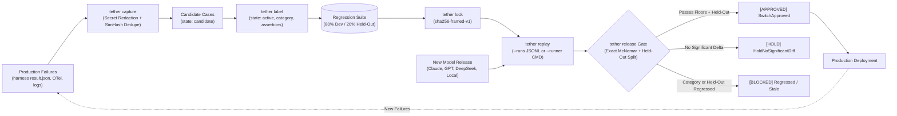

<div align="center">

# tether: TideOS Eval Kit (Tool 15)

**Continuous Production Failure Harvesting, Automatic Secret-Scrubbed Regression Cases, Full Suite Offline Replay, and Fail-Closed Model Release Gating**

[](https://github.com/TechTideOhio/tether/actions/workflows/ci.yml)
[](https://github.com/TechTideOhio/tether/releases/latest)
[](LICENSE)
[](Cargo.toml)
[](Cargo.toml)

[Quickstart](#60-second-quickstart) | [Why tether?](#why-tether) | [The Three Invariants](#the-three-invariants-of-tether) | [Loop Invariants Table](#loop-invariants-reference-table) | [Architectural Foundations](#architectural-foundations) | [Feature Matrix](#feature-comparison-matrix) | [The Complete TideOS Eval Kit](#the-complete-tideos-eval-kit) | [Contributing](CONTRIBUTING.md)

</div>

---

## Why tether?

Most evaluation suites suffer from a fatal flaw: they are static artifacts created once during project inception and left behind as production evolves. Meanwhile, agents crash in production, leak credentials, hit infinite loops, or fail on subtle edge cases, and engineers patch the immediate code without locking in a regression case.

`tether` implements the closing loop of modern AI engineering:

> *"Close the loop. Every production failure becomes a new labeled test case. Every new model release gets run against the full suite before anyone debates switching. Over time your eval set becomes the most valuable asset in the codebase."*



---

## The Three Invariants of tether

### 1. Invariant 1: No Closed Bug Without a Reproduction Case
`tether close <failure_id>` refuses to mark a production incident or task failure as resolved unless an active test case exists that fails on the buggy baseline and passes on the fix. The evaluation suite is the living contract of system reliability.

### 2. Invariant 2: Secret-Scrubbed Fingerprinted Ingest
Failures from production runs contain live environment artifacts, user paths, API tokens, and session credentials. `tether capture` runs a deterministic fail-closed redaction engine before computing exact SHA-256 and 64-bit word 3-shingle SimHash fingerprints. Near-duplicate failures (Hamming distance <= 3) automatically increment failure frequency counts rather than polluting the suite with identical cases.

### 3. Invariant 3: Held-Out Partitioning and Anti-Overfit Model Release Gate
Optimizing system prompts or fine-tuning models against a known benchmark inevitably overfits. `tether` deterministically stratifies cases into 80% development and 20% held-out partitions. A model release is blocked if it achieves high dev pass rates while regressing on the held-out partition (`BlockedHeldOutRegression`). Furthermore, releases are blocked if the suite has stagnated without incorporating fresh production failures (`BlockedSuiteStale`).

---

## Loop Invariants Reference Table

| Loop Invariant | Purpose | Enforcement Engine | Failure Consequence |
|---|---|---|---|
| **1. Bug Reproduction Case** | Production bug cannot close without test | `tether close <failure-id>` | Blocker: Refuses closure |
| **2. Secret-Scrubbed Capture** | Strip all API keys, PII, paths | `src/redact.rs` Fail-closed | RedactionFailure exception |
| **3. SimHash Deduplication** | Cluster near-duplicate crashes | SimHash64 Hamming dist <= 3 | Merges frequency counter |
| **4. Held-Out Anti-Overfit** | Detect prompt tuning cherry-picking | 20% Held-Out Split | BlockedHeldOutRegression |
| **5. Suite Freshness** | Prevent stagnant eval suite releases | `min_new_cases_per_release` | BlockedSuiteStale |
| **6. Category Regression Floor** | Prevent stealth degradation | `category.<name>.floor` | BlockedCategoryRegression |
| **7. Cryptographic Sealing** | Prevent tampering with cases | `sha256-framed-v1` lockfile | Drift mismatch fails gate |
| **8. Sequential Provenance** | Immutable loop history chain | SHA-256 Merkle Ledger | Chain breach fails gate |

---

## 60-Second Quickstart

### 1. Build Single Static Release Binary
```bash
cargo build --release
# Stripped standalone binary: target/release/tether (1.92 MB)
```

### 2. Display Loop Invariants Table
```bash
./target/release/tether table
```

### 3. Initialize a New Evaluation Suite
```bash
./target/release/tether init --suite ./evals/suite --spec ./packs/softfactory.toml
```

### 4. Ingest and Redact a Production Failure
```bash
./target/release/tether capture --from ./Tools/agent-harness/runs/2026-10-18-16-26-17-opencode-desktop/result.json --suite ./evals/suite
```

### 5. Label and Activate the Case
```bash
./target/release/tether label --case tc-2026-10-18-0001 --category tool-not-installed --expect-status error --expect-regex-absent "(?i)api[_-]?key" --suite ./evals/suite
```

### 6. Run Paired Model Release Gate
```bash
./target/release/tether release --spec ./packs/softfactory.toml --baseline ./packs/fixtures/baseline_runs.jsonl --candidate ./packs/fixtures/candidate_better.jsonl
```

---

## Architectural Foundations

`tether` is engineered around three core design pillars:

### 1. Extreme Craft & Desktop Ergonomics
- **Compact Standalone Binary**: Compiles to a **`1.92 MB`** static binary with zero external FFI, zero dynamic linker requirements, and sub-10ms evaluation execution.
- **Terminal Audio Alert Bell**: Emits the signature ASCII `\x07` alert bell on any regression, blocker breach, or invariant violation, providing instant audible feedback during local development.
- **Developer-First Scorecard**: Renders beautiful ANSI scorecards locally, universal `HarnessEnvelope<T>` for automation, and native GitHub Actions summaries in CI.
- **Strict Typography Discipline**: Zero em-dashes and zero en-dashes across all code, documentation, and error strings.

### 2. Production Failure Harvesting & Living Evaluations
- **Closing the Evaluation Loop**: Bridges production agent runtime logs, harness execution traces, and model upgrade decisions into a single continuous feedback cycle.
- **Preventing Suite Stagnation**: Evaluation suites that do not ingest new failures become obsolete vanity benchmarks. `tether` enforces minimum new case quotas before model releases can be certified.
- **Open Standards**: Native generation of W3C OpenTelemetry spans (`eval.pass_rate`, `eval.delta_pass_rate`, `eval.mcnemar_p_value`) for enterprise observability platforms.

### 3. Mathematical Rigor & Cryptographic Integrity
- **Zero Hand-Waving Statistics**: Exact binomial McNemar test for paired discordance, Wilson 95% score intervals for category pass rates, and deterministic SplitMix64 bootstrap confidence intervals on delta performance.
- **Anti-Overfitting Partitions**: Deterministic 80% dev / 20% held-out splitting ensures prompt engineering and fine-tuning cannot cherry-pick or overfit to evaluation cases.
- **Append-Only Merkle Ledgers**: Cryptographic hash chaining (`tether-run-v1`) guarantees immutable evaluation records from genesis to head.
- **sha256-framed-v1 Lockfiles**: Sealing specifications, cases, and category thresholds into cryptographic lockfiles prevents silent evaluation drift.

---

## Feature Comparison Matrix

| Capability | `tether` (TideOS) | Naive Benchmark Scripts | Promptfoo | LangSmith / Cloud Evals |
|---|:---:|:---:|:---:|:---:|
| **Zero External Network / Zero-FFI** | **Yes (Pure Rust)** | Partial | Node.js | No (Cloud SaaS) |
| **Enforced Bug Closure Invariant** | **Yes (`tether close`)** | No | No | No |
| **Fail-Closed Secret Redactor** | **Yes (Built-in)** | No | No | Partial |
| **64-bit SimHash Near-Deduplication** | **Yes (Word 3-shingle)** | No | No | No |
| **Held-Out Partition Anti-Overfitting** | **Yes (20% Split)** | No | No | Manual |
| **Suite Staleness Release Gate** | **Yes (Min new cases)** | No | No | No |
| **Exact Paired McNemar Test** | **Yes (Discordance)** | No | No | No |
| **Seeded SplitMix64 Bootstrap CIs** | **Yes (Zero-deps)** | No | No | No |
| **Cryptographic Lockfile** | **Yes (`sha256-framed-v1`)** | No | No | Cloud DB |
| **Sequential Merkle Provenance** | **Yes (`tether-run-v1`)** | No | No | No |
| **Binary Footprint** | **1.92 MB** | Large Python/Node | Large Node.js | SaaS Only |

---

## The Complete TideOS Eval Kit

| Tool # | Crate | Binary | Companion Skill | Size | Primary Evaluation Role |
|---|---|---|---|---|---|
| **1** | `reval` | `reval` | `trace-error-analysis` | `2.07 MB` | Trace Error Analysis (Open/Axial Coding), Rubric Gates, MCP Server |
| **2** | `gild` | `gild` | `golden-dataset-contract` | `2.46 MB` | Golden Dataset Governance, Schema Validation & Versioning |
| **3** | `tessel` | `tessel-eval` | `synthetic-eval-dimensions` | `1.97 MB` | Combinatorial Synthetic Scenario Generator (Pairwise Covering Arrays) |
| **4** | `assay` | `assay-eval` | `deterministic-assertions-first` | `2.09 MB` | Deterministic Assertions First (Layers 1-5) & In-Memory RLS |
| **5** | `tide-rill` | `tide-rill` | `offline-retrieval-faithfulness` | `1.54 MB` | Offline Retrieval Ranking & Context Faithfulness |
| **6** | `keel` | `keel-eval` | `trajectory-evals` | `1.91 MB` | Agent Trajectory Alignment & Step Efficiency (14 vs 3 calls) |
| **7** | `temper` | `temper-eval` | `pass-k-reliability` | `0.89 MB` | Multi-Trial Reliability (pass@k vs pass^k at Real Temperature) |
| **8** | `parley` | `parley-eval` | `simulated-user-evals` | `1.77 MB` | Simulated Users for Multi-Turn State, Memory & Policy Evals |
| **9** | `gavel` | `gavel-eval` | `llm-judge-calibration` | `1.78 MB` | Classifier-Calibrated LLM Judge, TPR/TNR & Rogan-Gladen Debiasing |
| **10** | `poise` | `poise-eval` | `pairwise-judge-bias` | `1.89 MB` | Pairwise A/B Position Bias Control, Length Capping & LC-WinRate |
| **11** | `plumb` | `plumb-eval` | `paired-statistical-significance` | `0.85 MB` | Paired Statistical Significance, Bootstrap BCa, Exact McNemar & TOST |
| **12** | `weir` | `weir-eval` | `eval-harness` | `1.76 MB` | CI Deployment Regression Gate, Per-Category Thresholds & PR Reporting |
| **13** | `eddy` | `eddy-eval` | `online-evals-production` | `0.92 MB` | Online Production Evals, Hash Sampling, CUSUM Drift & Shadow Replay |
| **14** | `tare` | `tare-eval` | `cost-latency-economics` | `0.86 MB` | First-Class Cost & Latency Metrology, Tokens/Req, CPST & Pareto Gating |
| **15** | **`tether`** | **`tether-eval`** | **`close-the-loop-evals`** | **`1.92 MB`** | **Continuous Production Failure Ingest, Regression Harvesting & Model Release Gating** |

---

## Architecture & Clippy Strictness

- **Zero Unsafe**: Entire crate compiled under `#![forbid(unsafe_code)]`.
- **Zero FFI**: Pure Rust dependencies only (`anyhow`, `clap`, `regex`, `serde`, `serde_json`, `sha2`, `thiserror`, `toml`).
- **Binary Footprint**: Stripped release binary budgeted under 2.0 MB (achieved **1.92 MB**).
- **Universal JSON Envelope**: All commands support `--json` emitting canonical `HarnessEnvelope<T>`.
- **Zero Em-Dash Rule**: Strictly enforces zero em-dashes and zero en-dashes across all code and documentation.

---

## About

`tether` is developed by Alex Cinovoj and the engineering team at [TechTide AI](https://techtideai.io) as part of the TideOS Eval Kit.

For enterprise evaluations, custom agent harnesses, and autonomous development infrastructure, visit [techtideai.io](https://techtideai.io).

---

## License

MIT License. Copyright (c) 2026 [TechTide AI](https://techtideai.io). See [LICENSE](LICENSE) for details.
